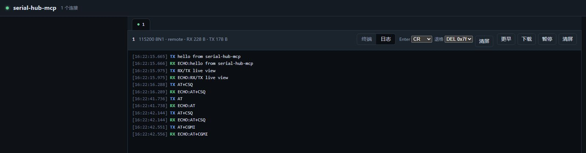
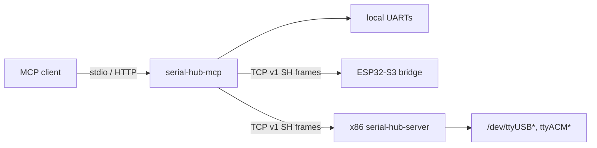

# serial-hub-mcp

> One MCP server for local and remote serial ports — byte-transparent I/O, durable logs, and a
> browser terminal.

[](https://github.com/yhuan416/serial-hub-mcp/actions/workflows/ci.yml)
[](https://github.com/yhuan416/serial-hub-mcp/releases/latest)
[](LICENSE)
[](https://nodejs.org/)
[](https://m8ven.ai/mcp/yhuan416-serial-hub-mcp-j8uwb6?s=readme)

中文说明：[README.zh.md](README.zh.md)

**Contents:** [Quick start](#quick-start) · [Tools](#tools) · [Configuration](#configuration)
· [Deployment](#deployment) · [Documentation](#documentation) · [Security](#security)

`serial-hub-mcp` is an MCP server that is also a serial hub. One process can hold multiple
local UARTs plus remote serial endpoints — an ESP32-S3 wireless bridge or an x86/Linux
`serial-hub-server` that exposes all of its local ports.

The byte plane is intentionally boring: bytes in, bytes out, no framing, no prompt/regex
interpretation. Content judgement is left to the agent. The host splits lines for retrieval,
assigns log sequence numbers, and keeps the raw hex as the source of truth.



## Why

- **One interface for local and remote**: the same `read` / `write` / `transact` / `receive`
  tools work whether the port is on the host, an ESP32, or another Linux box.
- **Byte-transparent**: no hidden framing or prompt parsing; agents see what the device sent.
- **Durable host-side logs**: query by sequence, time, direction, or content; the device only
  keeps bytes that have not been ACKed.
- **Operable**: profiles, open history, DTR/RTS/BREAK, dump/download, and a Web terminal.

## Features

- **stdio + Streamable HTTP** transports; optional Bearer auth and unauthenticated
  `/health` / `/info`.
- **Local serial** via `serialport`: path, profile, `sn` / `vid` / `pid`, baud, parity, flow control.
- **Byte-accurate I/O**: `read` (cat), `transact` (write + wait, ignores pre-write noise),
  `receive` (windowed capture), `dump_to_file` (export a cached slice).
- **Control lines**: DTR/RTS with pulse for reset sequences, plus BREAK.
- **Durable logs**: v2 binary segments + SQLite(WAL) block indexes by default; JSONL legacy mode
  is still available.
- **Profiles and remotes**: save connection parameters, register remotes once, and let
  `list_ports` aggregate local and remote ports in parallel.
- **Remote link v1**: binary BATCH frames, ACK flow control, capture resume, single writer.
- **Web UI**: xterm terminal, live RX/TX log, history and download in `--http` mode.

## Quick start

### Requirements

- Node.js >= 18 (CI covers 18/20/22; the Docker image uses Node 22).
- Linux: add your user to `dialout` for `/dev/ttyUSB*` / `/dev/ttyACM*`.
- Optional: Docker for the x86 `serial-hub-server`.

### Install from source

The package is not published on npm yet.

```bash
git clone https://github.com/yhuan416/serial-hub-mcp.git
cd serial-hub-mcp
npm ci

node src/server.js          # stdio
node src/server.js --http   # HTTP + Web UI on 127.0.0.1:8787
```

Optional: `npm link` puts `serial-hub-mcp` and `serial-hub-server` on your PATH.

### MCP client configuration

stdio:

```json
{
  "mcpServers": {
    "serial": {
      "command": "node",
      "args": ["/absolute/path/to/serial-hub-mcp/src/server.js"]
    }
  }
}
```

After `npm link`, `"command": "serial-hub-mcp"` is enough.

Streamable HTTP:

```bash
SERIAL_HUB_MCP_HTTP_TOKEN=change-me node src/server.js --http --host 0.0.0.0 --port 8787
```

```json
{
  "mcpServers": {
    "serial-hub": {
      "type": "http",
      "url": "http://127.0.0.1:8787/mcp",
      "headers": { "Authorization": "Bearer change-me" }
    }
  }
}
```

Non-loopback HTTP binds require a token; see [Security](#security).

### First calls

```text
list_ports()
open({ port: "/dev/ttyUSB0", baud_rate: 115200 })
receive({ connection_id: "...", start: "flush", budget_ms: 5000 })
transact({ connection_id: "...", data: "AT", newline: "crlf", match: "OK" })
close({ connection_id: "..." })
```

Remote:

```text
open({ remote: "lab-x86", port_id: "ttyACM0", baud_rate: 921600 })
open({ transport: "remote", endpoint: "tcp://192.168.4.67:7000", token: "...", port_id: "uart1" })
```

## Tools

| Tool                                               | What it does                                             |
| -------------------------------------------------- | -------------------------------------------------------- |
| `list_ports`                                       | Local ports plus every configured remote                 |
| `open` / `close`                                   | Open or close a connection                               |
| `open_list`                                        | Ports opened before, deduped by endpoint/port/baud       |
| `get_status`                                       | State, counters, control-line levels                     |
| `read`                                             | Read bytes since the cursor                              |
| `write`                                            | Send bytes                                               |
| `transact`                                         | Write then wait for a response                           |
| `receive`                                          | Capture a window until match / idle / budget / max bytes |
| `dump_to_file`                                     | Export a cached slice by seq, time, or offset            |
| `set_dtr_rts` / `send_break`                       | Control lines and BREAK                                  |
| `profile_list` / `profile_save` / `profile_delete` | Reusable connection profiles                             |
| `log_query` / `log_stats` / `log_clear`            | Query, inspect, clear host logs                          |
| `service_info`                                     | Service name, version, changelog                         |

Full parameters, examples, and read-only/destructive hints: [docs/tools.md](docs/tools.md).

## Configuration

Common variables; the full table is in [docs/configuration.md](docs/configuration.md).

| Variable                        | Default                                        | Purpose                                                   |
| ------------------------------- | ---------------------------------------------- | --------------------------------------------------------- |
| `SERIAL_HUB_MCP_HTTP`           | unset                                          | `1` enables HTTP mode                                     |
| `SERIAL_HUB_MCP_HTTP_HOST`      | `127.0.0.1`                                    | HTTP bind host                                            |
| `SERIAL_HUB_MCP_HTTP_PORT`      | `8787`                                         | HTTP bind port                                            |
| `SERIAL_HUB_MCP_HTTP_TOKEN`     | unset                                          | **Secret.** Bearer token; required for non-loopback binds |
| `SERIAL_HUB_MCP_HTTP_UI`        | `1`                                            | `0` disables the Web UI                                   |
| `SERIAL_HUB_MCP_STORE`          | `v2`                                           | `v2` (segments + SQLite) or `legacy` (JSONL)              |
| `SERIAL_HUB_MCP_CACHE_TTL_DAYS` | `7`                                            | Delete logs/dumps/captures older than this; `0` disables  |
| `SERIAL_HUB_MCP_REMOTES_FILE`   | `$XDG_CONFIG_HOME/serial-hub-mcp/remotes.json` | Remote registry                                           |
| `SERIAL_HUB_MCP_PROFILES_DIR`   | `$XDG_CONFIG_HOME/serial-hub-mcp`              | Directory containing `profiles.json`                      |

Paths use `$XDG_CACHE_HOME` (default `~/.cache`) and `$XDG_CONFIG_HOME` (default `~/.config`).

## Deployment

- **stdio**: run `node src/server.js` from your MCP client.
- **Streamable HTTP**: `--http` exposes `/mcp`, `/health`, `/info`, `/dumps/<file_id>`, and the
  Web UI at `/`.
- **Docker MCP**: [docker/serial-hub-mcp.Dockerfile](docker/serial-hub-mcp.Dockerfile) and the
  compose files in [docker/](docker/).
- **x86 serial hub**: [docs/x86-hub-server.md](docs/x86-hub-server.md).
- **Remote registry**: [docs/remotes.md](docs/remotes.md).

Operational details (reverse proxy, Docker mounts, systemd, Harbor, rollback):
[docs/deployment.md](docs/deployment.md).

## Architecture



The host owns line splitting, `seq`, logs, and read cursors. The remote only keeps bytes that
have not been ACKed. Wire format: [docs/remote-link-protocol-v1.md](docs/remote-link-protocol-v1.md).

## Documentation

| Doc                                            | What                                       |
| ---------------------------------------------- | ------------------------------------------ |
| [Getting started](docs/getting-started.md)     | Install, client config, first calls        |
| [Tools](docs/tools.md)                         | Full tool reference and examples           |
| [Configuration](docs/configuration.md)         | Every environment variable and path        |
| [Deployment](docs/deployment.md)               | stdio, HTTP, Docker, systemd, Harbor       |
| [Remotes](docs/remotes.md)                     | `remotes.json` and aggregated `list_ports` |
| [x86 hub-server](docs/x86-hub-server.md)       | Multi-port Linux service                   |
| [Protocol v1](docs/remote-link-protocol-v1.md) | Binary wire contract                       |
| [Storage](docs/storage.md)                     | Log model, v2 store, retention, dumps      |
| [Troubleshooting](docs/troubleshooting.md)     | Common errors and diagnostics              |
| [Development](docs/development.md)             | Tests, lint, CI, release steps             |

## Development

```bash
npm ci
npm test          # unit tests + stdio/HTTP smoke; no hardware required
npm run lint
npm run smoke
npm run smoke:http
```

Remote tests start an in-process hub. CI runs Node 18, 20, and 22.

Release steps (version bump, tags, Harbor image, deployment) are in
[docs/development.md](docs/development.md#发布).

## Security

- The remote link and HTTP transport are plaintext. Use a trusted LAN, VPN, or SSH tunnel.
- Binding a non-loopback HTTP address without `SERIAL_HUB_MCP_HTTP_TOKEN` is refused unless
  `--allow-anonymous` / `SERIAL_HUB_MCP_HTTP_ALLOW_ANONYMOUS=1` is set explicitly.
- Tokens are masked in tool output and `open_list`; prefer `token_env` in `remotes.json`.
- Report vulnerabilities privately; see [SECURITY.md](SECURITY.md).

## License

MIT. See [LICENSE](LICENSE).
