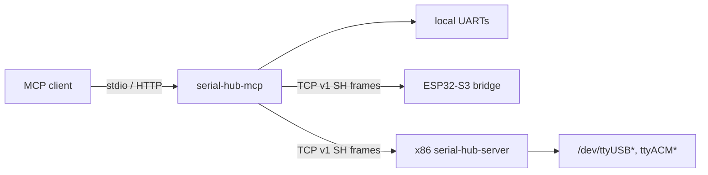

# serial-hub-mcp

> 一个 MCP server，同时管理本机 UART 和远端串口 —— 字节透明、日志可查、自带网页终端。

[](https://github.com/yhuan416/serial-hub-mcp/actions/workflows/ci.yml)
[](https://github.com/yhuan416/serial-hub-mcp/releases/latest)
[](LICENSE)
[](https://nodejs.org/)
[](https://m8ven.ai/mcp/yhuan416-serial-hub-mcp-j8uwb6?s=readme)

English: [README.md](README.md)

**目录：** [快速开始](#快速开始) · [工具](#工具) · [配置](#配置) · [部署](#部署)
· [文档](#文档) · [安全](#安全)

`serial-hub-mcp` 既是 MCP server，也是串口 hub。一个进程里可以同时握着多个本机 UART，以及
远端串口：ESP32-S3 无线桥，或跑在 Linux 上的 `serial-hub-server`（暴露该机器的所有串口）。

字节面保持透明：进什么出什么，不组帧、不判读提示符/正则，内容判断交给 agent。host 负责按行
切分、分配日志 `seq` 和保存原始 hex。

## 为什么

- **本机/远端同一套接口**：不管端口在本机、ESP32 还是另一台 Linux，agent 都用同一组
  `read` / `write` / `transact` / `receive`。
- **字节透明**：没有隐藏组帧或提示符解析，设备发什么 agent 就看到什么。
- **host 侧持久日志**：按 seq、时间、方向、内容检索；远端只保留还没被 ACK 的字节。
- **可运维**：profile、打开记录、DTR/RTS/BREAK、dump/下载，以及网页终端。

## 特性

- **stdio + Streamable HTTP** 两种传输；可选 Bearer 鉴权，`/health` / `/info` 免鉴权。
- **本机串口**：基于 `serialport`，支持路径、profile、`sn` / `vid` / `pid`、波特率、校验、流控。
- **字节级 I/O**：`read`（cat）、`transact`（写完等回包，忽略写前噪声）、
  `receive`（窗口式采集）、`dump_to_file`（导出缓存片段）。
- **控制线**：DTR/RTS（可脉冲复位）和 BREAK。
- **持久日志**：默认 v2 二进制 segment + SQLite(WAL) block 索引；仍可用 `legacy` JSONL。
- **profile 与 remote**：保存常用参数、注册远端，`list_ports` 并行汇总本机和远端端口。
- **远端 v1 链路**：二进制 BATCH、ACK 流控、capture 续传、单 writer。
- **网页界面**：`--http` 下提供 xterm 终端、实时 RX/TX、历史加载和下载。

## 快速开始

### 环境要求

- Node.js >= 18（CI 覆盖 18/20/22；Docker 镜像用 Node 22）。
- Linux：把用户加进 `dialout`，否则打不开 `/dev/ttyUSB*` / `/dev/ttyACM*`。
- 可选：Docker，用于跑 x86 `serial-hub-server`。

### 从源码安装

目前还没有发布到 npm。

```bash
git clone https://github.com/yhuan416/serial-hub-mcp.git
cd serial-hub-mcp
npm ci

node src/server.js          # stdio
node src/server.js --http   # HTTP + 网页界面，默认 127.0.0.1:8787
```

可选：`npm link` 后，`serial-hub-mcp` 和 `serial-hub-server` 会进入 PATH。

### MCP 客户端配置

stdio：

```json
{
  "mcpServers": {
    "serial": {
      "command": "node",
      "args": ["/absolute/path/to/serial-hub-mcp/src/server.js"]
    }
  }
}
```

`npm link` 之后，`"command": "serial-hub-mcp"` 即可。

Streamable HTTP：

```bash
SERIAL_HUB_MCP_HTTP_TOKEN=change-me node src/server.js --http --host 0.0.0.0 --port 8787
```

```json
{
  "mcpServers": {
    "serial-hub": {
      "type": "http",
      "url": "http://127.0.0.1:8787/mcp",
      "headers": { "Authorization": "Bearer change-me" }
    }
  }
}
```

绑非回环地址必须设 token；见 [安全](#安全)。

### 第一次调用

```text
list_ports()
open({ port: "/dev/ttyUSB0", baud_rate: 115200 })
receive({ connection_id: "...", start: "flush", budget_ms: 5000 })
transact({ connection_id: "...", data: "AT", newline: "crlf", match: "OK" })
close({ connection_id: "..." })
```

远端：

```text
open({ remote: "lab-x86", port_id: "ttyACM0", baud_rate: 921600 })
open({ transport: "remote", endpoint: "tcp://192.168.4.67:7000", token: "...", port_id: "uart1" })
```

## 工具

| 工具                                               | 作用                                          |
| -------------------------------------------------- | --------------------------------------------- |
| `list_ports`                                       | 本机端口 + 所有已配置远端                     |
| `open` / `close`                                   | 打开/关闭连接                                 |
| `open_list`                                        | 打开过的端口，按 endpoint/port/baud 去重      |
| `get_status`                                       | 状态、计数、控制线电平                        |
| `read`                                             | 从读游标读取字节                              |
| `write`                                            | 发送字节                                      |
| `transact`                                         | 写入后等待回包                                |
| `receive`                                          | 采集窗口，直到 match / 静默 / 预算 / 字节上限 |
| `dump_to_file`                                     | 按 seq、时间或 offset 导出缓存                |
| `set_dtr_rts` / `send_break`                       | 控制线与 BREAK                                |
| `profile_list` / `profile_save` / `profile_delete` | 连接参数复用                                  |
| `log_query` / `log_stats` / `log_clear`            | 查询、统计、清空 host 日志                    |
| `service_info`                                     | 服务名、版本、changelog                       |

完整参数、示例和只读/破坏性提示：[docs/tools.md](docs/tools.md)。

## 配置

常用变量；完整表见 [docs/configuration.md](docs/configuration.md)。

| 变量                            | 默认                                           | 说明                                         |
| ------------------------------- | ---------------------------------------------- | -------------------------------------------- |
| `SERIAL_HUB_MCP_HTTP`           | 未设置                                         | `1` 启用 HTTP 模式                           |
| `SERIAL_HUB_MCP_HTTP_HOST`      | `127.0.0.1`                                    | HTTP 绑定地址                                |
| `SERIAL_HUB_MCP_HTTP_PORT`      | `8787`                                         | HTTP 绑定端口                                |
| `SERIAL_HUB_MCP_HTTP_TOKEN`     | 未设置                                         | **密钥。** Bearer token；绑非回环地址时必填  |
| `SERIAL_HUB_MCP_HTTP_UI`        | `1`                                            | `0` 关闭网页界面                             |
| `SERIAL_HUB_MCP_STORE`          | `v2`                                           | `v2`（segment + SQLite）或 `legacy`（JSONL） |
| `SERIAL_HUB_MCP_CACHE_TTL_DAYS` | `7`                                            | 日志/dump/捕获保留天数；`0` 关闭             |
| `SERIAL_HUB_MCP_REMOTES_FILE`   | `$XDG_CONFIG_HOME/serial-hub-mcp/remotes.json` | 远端注册表                                   |
| `SERIAL_HUB_MCP_PROFILES_DIR`   | `$XDG_CONFIG_HOME/serial-hub-mcp`              | `profiles.json` 目录                         |

路径默认按 `$XDG_CACHE_HOME`（`~/.cache`）和 `$XDG_CONFIG_HOME`（`~/.config`）。

## 部署

- **stdio**：在 MCP 客户端里直接运行 `node src/server.js`。
- **Streamable HTTP**：`--http` 提供 `/mcp`、`/health`、`/info`、`/dumps/<file_id>` 和网页界面。
- **Docker MCP**：[docker/serial-hub-mcp.Dockerfile](docker/serial-hub-mcp.Dockerfile) 与
  [docker/](docker/) 下的 compose。
- **x86 串口服务**：[docs/x86-hub-server.md](docs/x86-hub-server.md)。
- **远端注册表**：[docs/remotes.md](docs/remotes.md)。

反向代理、Docker 挂载、systemd、Harbor、回滚等运维细节：
[docs/deployment.md](docs/deployment.md)。

## 架构



host 负责切行、`seq`、日志和读游标；远端只保留未 ACK 的字节。线格式见
[docs/remote-link-protocol-v1.md](docs/remote-link-protocol-v1.md)。

## 文档

| 文档                                           | 内容                                 |
| ---------------------------------------------- | ------------------------------------ |
| [Getting started](docs/getting-started.md)     | 安装、客户端配置、第一次调用         |
| [Tools](docs/tools.md)                         | 完整工具参考与示例                   |
| [Configuration](docs/configuration.md)         | 全部环境变量与路径                   |
| [Deployment](docs/deployment.md)               | stdio、HTTP、Docker、systemd、Harbor |
| [Remotes](docs/remotes.md)                     | `remotes.json` 与 `list_ports` 汇总  |
| [x86 hub-server](docs/x86-hub-server.md)       | 多端口 Linux 服务                    |
| [Protocol v1](docs/remote-link-protocol-v1.md) | 二进制线格式契约                     |
| [Storage](docs/storage.md)                     | 日志模型、v2 store、保留、dump       |
| [Troubleshooting](docs/troubleshooting.md)     | 常见错误与排查                       |
| [Development](docs/development.md)             | 测试、lint、CI、发布流程             |

## 开发

```bash
npm ci
npm test          # 单测 + stdio/HTTP smoke；不需要硬件
npm run lint
npm run smoke
npm run smoke:http
```

远端测试会在进程内起一个 hub。CI 跑 Node 18/20/22。

版本号、tag、Harbor 镜像和部署步骤见
[docs/development.md](docs/development.md#发布)。

## 安全

- 远端链路和 HTTP 都是明文，只在可信局域网、VPN 或 SSH 隧道里用。
- 绑非回环 HTTP 地址但没设 `SERIAL_HUB_MCP_HTTP_TOKEN` 时会拒绝启动；确需匿名访问要显式加
  `--allow-anonymous` / `SERIAL_HUB_MCP_HTTP_ALLOW_ANONYMOUS=1`。
- 工具返回和 `open_list` 会打码 token；`remotes.json` 推荐用 `token_env`。
- 安全问题请私下报告，见 [SECURITY.md](SECURITY.md)。

## License

MIT，见 [LICENSE](LICENSE)。
