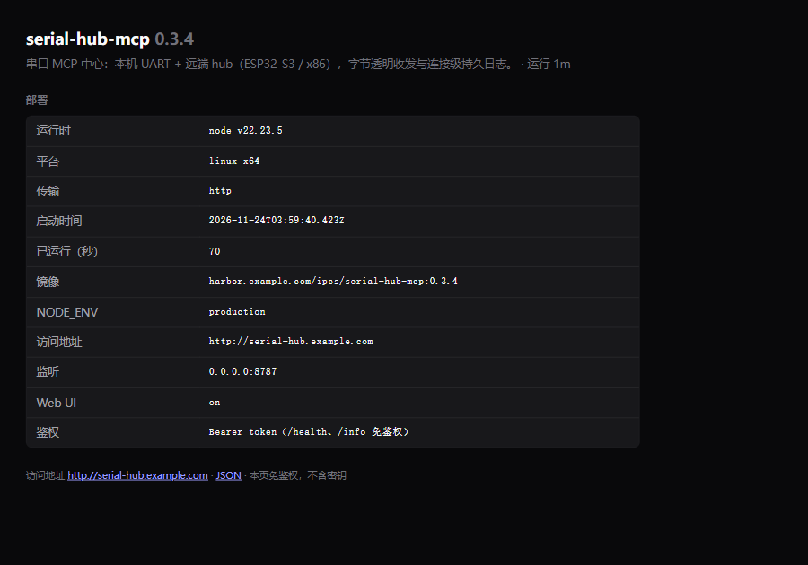

# /info：服务自描述页

部署好的服务应该能自己说清楚「我是谁、哪个版本、数据放哪、怎么接」。`/info` 就是这张脸：

- 运维：浏览器打开就能看到版本、访问地址、存储、限额、端点。
- 脚本/客户端：同一个 URL 拿 JSON，字段稳定，方便巡检和转发。
- agent：MCP 的 `service_info` 工具返回同一份数据，不用两处维护。

两个服务都实现了这套约定：



| 服务                 | 地址                                   | 实现                                         |
| -------------------- | -------------------------------------- | -------------------------------------------- |
| `serial-hub-mcp`     | `http://<host>:8787/info`（HTTP 模式） | `src/info.js` + `src/sdk/info-page.js`       |
| `serial-hub-server`  | `http://<host>:7000/info`（同端口）    | `src/hub-server/info.js`（首字节嗅探 HTTP）  |

`serial-hub-server` 的主端口是二进制 SH 帧；连接首字节是 `GET` / `HEAD` 时按 HTTP 处理，
所以不需要额外开端口，浏览器直接打开 `http://<hub>:7000/info` 即可。

## 五段骨架

页面固定按这五段渲染，缺哪段就不渲染哪段：

| 段落     | 回答的问题                             | 典型字段                                                       |
| -------- | -------------------------------------- | -------------------------------------------------------------- |
| 部署     | 跑的什么、哪个版本、地址是什么         | runtime、platform、version、publicUrl、listen、startedAt、uptime |
| 存储     | 数据在哪、多大、怎么淘汰               | 目录路径 + 文件数/体积、保留上限、TTL                          |
| 限制     | 有什么硬上限、鉴权方式                 | 请求体上限、工具数、帧/环形缓冲、窗口、租约                    |
| 端点     | 每个路径是干什么的、要不要 token       | path + auth + desc                                             |
| 接入步骤 | 客户端配置、注册命令、验证命令（可粘贴） | MCP 配置片段、remotes.json、`curl` 验证                        |

可选第六段：变更摘要（`changelog`，默认取最近 20 行）。

## 三个约定

1. **同一路径两种表示**：默认 JSON；`?format=html`、`?format=json` 显式指定；
   浏览器（`Accept: text/html`）自动给页面，`curl`（`Accept: */*`）自动给 JSON。
2. **免鉴权、不含密钥**：页面和 JSON 都能匿名访问，但不读 token、不展示
   `remotes.json` 里的 endpoint/token；只暴露部署形态和端口列表。
3. **与 `service_info` 同源**：MCP 工具与 HTTP 端点共用同一个构建函数，字段一致；
   改字段时两处一起改。

## 访问地址（`PUBLIC_URL`）

页面上的「访问地址」按这个顺序取：

1. `SERIAL_HUB_MCP_PUBLIC_URL` / `SERIAL_HUB_SERVER_PUBLIC_URL`（显式配置，推荐容器部署时设置）；
2. 请求的 `Host` 头（浏览器访问时天然正确，反代时记得转发 `X-Forwarded-Proto`）；
3. 监听地址仅在本机回环时兜底。

**不要用容器 hostname 拼地址**——容器里 `os.hostname()` 是容器 ID，对人没有意义，
也没法直接转发给别人。

## 复用模板

新服务照抄这四步（渲染函数在 `src/sdk/info-page.js`，已在仓库里）：

```js
import { dirStats, formatBytes, resolvePublicUrl } from "./info-page.js";

function buildInfo(req) {
  const publicUrl = resolvePublicUrl({
    envUrl: process.env.MY_SERVICE_PUBLIC_URL,
    req,
    fallback: "http://127.0.0.1:8787",
  });
  return {
    service: "my-service",
    version: "1.2.3",
    summary: "一句话说明这个服务干什么。",
    deployment: {
      runtime: `node ${process.version}`,
      platform: `${process.platform} ${process.arch}`,
      publicUrl,
      listen: "0.0.0.0:8787",
      startedAt: new Date(STARTED_AT).toISOString(),
      uptimeSeconds: Math.round((Date.now() - STARTED_AT) / 1000),
    },
    storage: {
      dataDir: "/data",
      dataDirSize: `${dirStats("/data")?.files ?? 0} 个文件`,
      retainBytes: formatBytes(512 * 1024 * 1024),
    },
    limits: { bodyBytes: formatBytes(4 * 1024 * 1024), tools: 19 },
    endpoints: {
      mcp: { path: "/mcp", auth: "Bearer token", desc: "MCP Streamable HTTP" },
      info: { path: "/info", auth: "免鉴权", desc: "本页；?format=html 可读版" },
    },
    integration: {
      hint: "把下面几段贴到客户端；token 从环境变量或 secret 文件取。",
      snippets: [{ title: "MCP 客户端", code: '{"mcp":{"my-service":{"type":"remote","url":"..."}}}' }],
    },
  };
}
```

接到 HTTP 服务上（`src/sdk/http.js` 已内置协商和页面渲染）：

```js
import { buildServiceInfo } from "./service-info.js";

runHttp({
  // ...
  info: (req) => buildServiceInfo({ service: "my-service", version, dynamic: () => buildInfo(req) }),
});
```

MCP 工具侧同样传 `dynamic`（`createServiceInfoTool`），保证两边一致：

```js
createServiceInfoTool({ service: "my-service", version, dynamic: () => buildInfo() });
```

## 自检清单

- [ ] `curl /info` 是 JSON，`curl '/info?format=html'` 是 HTML，浏览器直接开也是 HTML。
- [ ] `?format=json` 强制 JSON；`Accept: text/html` 强制页面。
- [ ] 匿名访问可用，返回内容里搜不到 token / 密钥。
- [ ] 显示的访问地址是能直接复制给别人用的（不是容器 ID）。
- [ ] 断开 `PUBLIC_URL` 时能用 `Host` 头兜底；反代场景验证过 `X-Forwarded-Proto`。
- [ ] MCP 的 `service_info` 与 `/info` 字段一致。
- [ ] 页面自包含：没有外链 CSS/JS/字体，离线也能看。
- [ ] 存储统计是「直接子文件、条目有上限」，大目录不会拖慢请求。